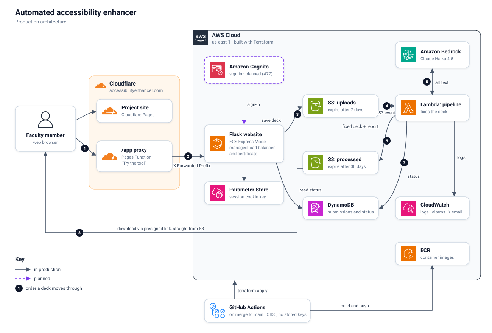

# Automated Accessibility Enhancer

[](https://github.com/t-nair/automated-accessibility-enhancer/actions/workflows/ci.yml)

Upload a PowerPoint or a PDF, get back a more accessible file and a report that says what was wrong with it. Try it at [accessibilityenhancer.com](https://accessibilityenhancer.com).

The Accessibility Enhancer fixes what it safely can (slide reading order, missing image descriptions, document language, PDF tags) and lists everything else a person needs to look at, scored by severity and mapped to WCAG 2.1. Image descriptions are written by Claude on Amazon Bedrock.

It was built as part of the **University of Washington Advancing Accessibility for Engineering Education** initiative, under the guidance of **Prof. Anant** and **Dr. Lalitha Subramanian**, and presented at **EDUCAUSE 2025 Online** as part of a broader effort to scale accessibility remediation in instructional materials.

---

## What it does

- **PowerPoint** (`.pptx`, and `.ppt` through LibreOffice): fixes reading order, missing image descriptions and the presentation language; reports slides with no title, low contrast, small text and vague link text.
- **PDF:** rebuilds digital text as a tagged PDF with a title and language, reads scanned pages with local OCR, and stops for a person whenever it is not sure.
- **The report** scores the file as uploaded out of 100, lists every change before and after, and marks each problem critical, serious, moderate or minor with its WCAG criterion.
- **The web app** queues uploads with live progress, explains failures in plain words, and has no WCAG 2.1 A or AA violations in an axe-core audit.

"Reported" means the tool does not guess: a new title, colour or link wording is a design decision, left for a person. The full list, with an example report, is in [docs/what-it-checks.md](docs/what-it-checks.md).



---

## Quick start

You need **Python 3.11, 3.12 or 3.13** (OCR of scanned PDFs needs 3.11 or 3.12; on 3.13 those pages report that OCR is unavailable), and AWS credentials that can call Bedrock in `us-east-1` for image descriptions. Optional extras:

| Optional | For |
|---|---|
| LibreOffice | Old `.ppt` files. `.pptx` works without it |
| Chrome, Chromium or Edge | PDF uploads (set `PDF_PIPELINE_CHROME` if it is not found) |

```bash
git clone https://github.com/t-nair/automated-accessibility-enhancer.git
cd automated-accessibility-enhancer
python -m venv .venv
.venv\Scripts\Activate.ps1          # macOS/Linux: source .venv/bin/activate
pip install -r requirements-web.txt
python app.py
```

Open http://localhost:5000. To use another port, set `PORT` first (`$env:PORT=5001` in PowerShell).

**Image descriptions** use the usual AWS credentials (`AWS_ACCESS_KEY_ID` and `AWS_SECRET_ACCESS_KEY`, or a profile). `BEDROCK_MODEL_ID` picks the model and `BEDROCK_REGION` the region (default `us-east-1`). Without credentials, files are still fixed; pictures get a placeholder description that the report flags.

**LibreOffice:** `winget install --id TheDocumentFoundation.LibreOffice` on Windows, `sudo apt install libreoffice-impress` on Linux. Without it, `.ppt` uploads are turned away with a message explaining what to do.

On Windows, if `python` is not recognized, reinstall Python with "Add python.exe to PATH" ticked, or use `py`.

---

## Documentation

Everything else is in [docs/](docs/README.md):

- [What it checks and fixes](docs/what-it-checks.md), and [WCAG 2.1 coverage](docs/wcag-coverage.md)
- [Command line](docs/command-line.md) for folders of decks and single PDFs
- [How it works](docs/how-it-works.md), from upload to download
- [Deploying](docs/deployment.md) on your own server, and how production runs on AWS ([infra/](infra/README.md))
- [Contributing](CONTRIBUTING.md), including the tests

Open work is tracked in [issues](https://github.com/t-nair/automated-accessibility-enhancer/issues).

---

## Things to know

- **Descriptions are a starting point.** The model sometimes gets names and dates wrong. Every generated description is flagged in the report so it can be checked before a file reaches students.
- **There is no login yet.** Each browser gets a random id in a signed cookie, so nobody can open someone else's files, but clearing cookies loses your history. Sign-in with Amazon Cognito is in progress ([#77](https://github.com/t-nair/automated-accessibility-enhancer/issues/77)).
- **"Permission denied" or "in use" errors** usually mean the deck is open in PowerPoint or a sync app is holding it. Close it and retry.

---

## Contributing and contact

Contributions, bug reports and design discussion are welcome; see [CONTRIBUTING.md](CONTRIBUTING.md). You can reach the maintainer, Tanya Nair, by [email](mailto:tanyan07@uw.edu) or on [LinkedIn](https://www.linkedin.com/in/tanya-nair-617473287/).
