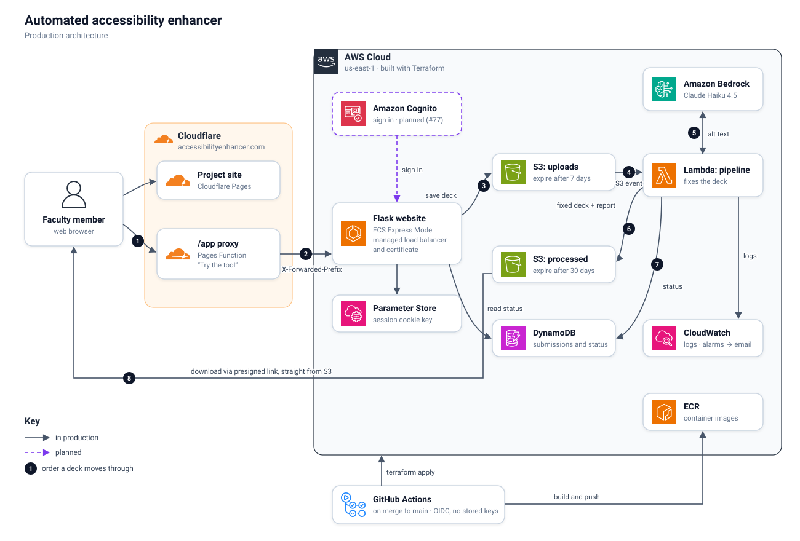

# Deploying the web page

The website is served by [Waitress](https://docs.pylonsproject.org/projects/waitress/),
which runs on Windows and Linux. Everything runs on the server itself except image
descriptions: each picture that needs one is sent to Claude on Amazon Bedrock.

The real site runs on AWS; see [Production](#production) below and
[infra/README.md](../infra/README.md) for how it is built and deployed. The rest of this
guide is for running it on one server of your own.

The [open decisions](#open-decisions) at the end still need an owner.

---

## Production



The diagram follows a deck from upload to download.

| | |
|---|---|
| Address | `https://accessibilityenhancer.com/app` ("Try the tool" on the project site) |
| Host | AWS, `us-east-1`: the website on ECS Express Mode, decks processed by Lambda, files in S3, submissions in DynamoDB ([infra/](../infra/README.md)) |
| Image descriptions | Claude on Amazon Bedrock, in the same AWS account. Local Qwen2-VL is no longer used (#97) |
| Certificates | Cloudflare issues and renews the one for `accessibilityenhancer.com`. ECS Express Mode issues and renews the one for its own `*.ecs.us-east-1.on.aws` address. Nobody renews anything by hand |
| Sign-in | Optional, with Amazon Cognito ([infra/README.md](../infra/README.md#sign-in)): email and password, or Google; Microsoft and NetID later. Anyone can use the tool without an account; after an upload, the app suggests one once, so their files follow them instead of staying in one browser |
| Who can use it | Anyone, with or without an account. Sign-up is not limited to certain email domains for now |
| Deploys | Every merge to `main`, from CI, after a reviewer approves the `production` environment |
| Owner | @t-nair owns the AWS account, approves production deploys, and watches the bill and the alarms |
| Backups | Files are versioned in S3 and can be restored for 3 days after they are deleted or overwritten; the submissions table can be restored to any second in the last 35 days ([infra/README.md](../infra/README.md#backups)) |

The project site ([automated-accessibility-enhancer-site](https://github.com/t-nair/automated-accessibility-enhancer-site))
is on Cloudflare Pages. A Pages Function there forwards `/app` to the ECS address and
sends `X-Forwarded-Prefix: /app`, so links in the app point back under `/app`.

The ECS address can also be reached directly, so the Cloudflare proxy cannot be what keeps
people out. The app itself checks sign-in against the Cognito user pool (#77). The AWS
load balancer can't do it, because ECS Express Mode manages that load balancer itself.
Without Cognito configured (on a laptop, or a server of your own) the app keeps
identifying visitors by a signed cookie, as it does today.

Files are not on a server disk in production. Uploads and results are in S3 and expire on
their own (uploads after 7 days, results after 30), and submissions are in DynamoDB.

---

## How the app runs (read this before changing any server setting)

- **One process, one worker thread.** When `app.py` is imported it starts a queue in
  memory and one background thread that takes files off it one at a time.
- **Progress is kept in memory** in that same process. The progress bar asks the process
  that handled the upload.
- **Submissions are in SQLite** (`data/submissions.db`). Each request opens its own
  connection.

So the app must run as **exactly one process**. More processes (Gunicorn `-w 4`, several
Waitress instances behind a load balancer, several containers) would each start their own
queue, and the progress bar shows 0
whenever a request lands on a process that is not the one doing the work. Gunicorn's
`--preload` is worse: the worker thread starts before the fork and does not survive it,
so nothing is ever processed.

Threads are fine. Web requests are short, because uploads are only saved and queued, and
Waitress reads the whole request body before handing it to the app, so a slow upload does
not hold a thread. Waitress's default of 4 threads is plenty. More threads would never
process more files at the same time.

Running files in parallel, or on a second machine, needs a shared queue and shared
progress first (see open decisions).

---

## What the server needs

| Need | Why |
|------|-----|
| Python 3.11 or 3.12 | OCR for scanned PDFs (`rapidocr-onnxruntime`) does not support newer versions |
| AWS credentials that can call Bedrock in `us-east-1` | Image descriptions. Without them pictures get a placeholder that the report flags |
| Room for uploads | See "Where data is kept" |
| LibreOffice (optional) | Only for old `.ppt` files |
| Chrome, Chromium or Edge | Only for PDF uploads; set `PDF_PIPELINE_CHROME` if it is not on `PATH` |
| A reverse proxy that handles HTTPS | Waitress does not do TLS |

---

## Install

```bash
git clone https://github.com/t-nair/automated-accessibility-enhancer.git /srv/accessibility-enhancer
cd /srv/accessibility-enhancer
python3.12 -m venv .venv
.venv/bin/pip install -r requirements-web.txt
.venv/bin/python -m pipeline.setup_models
```

---

## Environment variables

| Variable | Needed | What it does |
|----------|--------|--------------|
| `SECRET_KEY` | Yes | Signs the cookie that ties each visitor to their files. Keep it the same across restarts and secret. If unset, one is made and saved in `data/secret_key.txt`. Make one with `python -c "import secrets; print(secrets.token_hex(32))"` |
| `FLASK_SESSION_COOKIE_SECURE` | Yes, behind HTTPS | Set to `true` so the cookie is only sent over HTTPS |
| `AWS_ACCESS_KEY_ID`, `AWS_SECRET_ACCESS_KEY` | Yes, for descriptions | A key allowed only to call Bedrock (or any other way boto3 finds credentials) |
| `BEDROCK_REGION` | No | Where Bedrock is called (default `us-east-1`) |
| `BEDROCK_MODEL_ID` | No | The model that writes descriptions (default Claude Haiku 4.5) |
| `LOG_FILE` | No | Where the log is written as well as the console (default `pipeline.log`; empty for console only) |
| `MIN_FONT_PT` | No | Font size below which text is reported (default `9`) |
| `PDF_PIPELINE_CHROME` | Only if Chrome is not on `PATH` | Path to Chrome, Chromium or Edge for PDF export |
| `COGNITO_DOMAIN`, `COGNITO_CLIENT_ID`, `COGNITO_CLIENT_SECRET` | No | Turn on optional sign-in against a Cognito user pool. On AWS, Terraform sets these (with `COGNITO_CLIENT_SECRET_PARAMETER` in place of the secret). Without them there are no accounts |
| `PUBLIC_URL` | With sign-in | The address people reach the site at, without a trailing slash. Sign-in redirects are built from it, and the session cookie is marked Secure when it starts with `https://` |
| `HOST`, `PORT` | No | Address to listen on (default `127.0.0.1:5000`). Keep `127.0.0.1` behind a proxy on the same machine |

Any other `FLASK_`-prefixed variable sets the Flask setting of that name. Do not set
`FLASK_DEBUG` on a server.

---

## Where data is kept

All paths are relative to the **working directory**, so always start the app from the
project folder (`WorkingDirectory=` in systemd). Back up `data/`, `uploads/` and
`processed/` together; they only make sense as a set.

| Path | What | Keep across restarts? |
|------|------|------------------------|
| `data/submissions.db` | Every submission and its status | Yes |
| `data/secret_key.txt` | The cookie key, if `SECRET_KEY` is not set | Yes, or everyone loses their file list |
| `uploads/` | The original files people uploaded | Yes, retry needs them |
| `processed/` | Fixed files, reports and PDF output folders | Yes, downloads come from here |
| `pipeline.log` | Log of every file processed | Yes, rotate it (it is never trimmed) |
| `pipeline/ocr_models/` | OCR model for scanned PDFs | Yes |

These hold course material, so they must be on a disk only the service account can read,
and they must not be on storage that is wiped on redeploy (a container's own filesystem,
for example). Submissions and their files are deleted after 30 days
(`RETENTION_DAYS` in `storage_local.py`), and people can delete their own sooner from the
status page.

---

## Start command

```bash
.venv/bin/python app.py
```

This starts Waitress on `HOST`:`PORT` (default `127.0.0.1:5000`), so only the reverse
proxy on the same machine can reach it.

The app does not use `X-Forwarded-*` headers (every redirect is relative), so Waitress
needs no trusted-proxy settings.

For the Flask debugger on a laptop, use `flask --app app run --debug --no-reload`, never on
a server. (The reloader restarts the app in the middle of a file.)

### systemd (Linux)

`/etc/systemd/system/accessibility-enhancer.service`:

```ini
[Unit]
Description=Automated accessibility enhancer
After=network.target

[Service]
User=accessibility
WorkingDirectory=/srv/accessibility-enhancer
EnvironmentFile=/etc/accessibility-enhancer.env
ExecStart=/srv/accessibility-enhancer/.venv/bin/python app.py
Restart=on-failure

[Install]
WantedBy=multi-user.target
```

`/etc/accessibility-enhancer.env` (readable only by root and the service user):

```ini
SECRET_KEY=<the generated key>
FLASK_SESSION_COOKIE_SECURE=true
AWS_ACCESS_KEY_ID=<the Bedrock-only key>
AWS_SECRET_ACCESS_KEY=<its secret>
```

```bash
sudo systemctl enable --now accessibility-enhancer
```

On Windows, run `.venv\Scripts\python.exe app.py` from the project folder with a service
wrapper such as NSSM, and put the variables in the service's environment.

---

## Reverse proxy and HTTPS (nginx)

For a server of your own only; production does not use nginx. Replace
`accessibility.your-university.edu` and the certificate paths with your own.

```nginx
server {
    listen 80;
    server_name accessibility.your-university.edu;
    return 301 https://$host$request_uri;
}

server {
    listen 443 ssl;
    server_name accessibility.your-university.edu;

    ssl_certificate     /etc/ssl/certs/accessibility.pem;
    ssl_certificate_key /etc/ssl/private/accessibility.key;

    # each file can be up to 50 MB and several can be sent at once (see open decisions)
    client_max_body_size 205m;

    location / {
        proxy_pass http://127.0.0.1:5000;
        proxy_set_header Host $host;
    }
}
```

No long proxy timeouts are needed: processing happens after the upload request has
returned, and the page polls for progress.

---

## Restarting and upgrading

```bash
sudo systemctl restart accessibility-enhancer
```

The queue is only in memory, so on start the app puts every file still shown as "queued" or
"processing" back on the queue. A file in progress starts again from its original upload,
which is never moved or changed. If that original is gone, the file is marked as an error
that asks the person to upload it again.

---

## Open decisions

These are not settled in the code or the repository and need someone to decide:

1. **Upload limits.** Each file may be 50 MB (`MAX_FILE_SIZE_MB`) and one upload 250 MB
   (`MAX_REQUEST_SIZE_MB`). Cloudflare refuses request bodies over 100 MB on its Free and
   Pro plans, so through `accessibilityenhancer.com/app` one upload is in practice limited
   to 100 MB. On your own server, raise nginx's `client_max_body_size` to match. (#74)
2. **Keeping files.** Everything is deleted after 30 days (uploads after 7 on AWS).
   Confirm that period is right. (#78)
3. **More than one file at a time.** Needs a shared queue and progress outside the process.
   Until then, one process. (#104)
