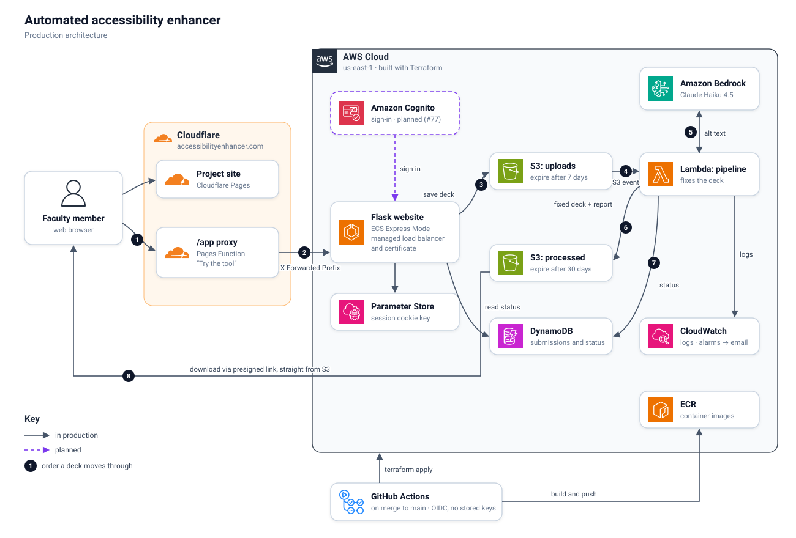

# How it works



## In production

On AWS the website never processes a deck itself. It saves the upload to S3, which
starts a Lambda that runs the PowerPoint pipeline, asks Claude on Bedrock for image
descriptions, writes the fixed file and report back to S3 and records progress in
DynamoDB. When `SUBMISSIONS_TABLE` is set, [app.py](../app.py) uses
[storage_aws.py](../storage_aws.py) and leaves processing to
[lambda_handler.py](../lambda_handler.py). PDFs are not processed on AWS yet. See
[deployment.md](deployment.md#production) and [infra/README.md](../infra/README.md).

## How a file is processed (on your own machine)


1. The upload is saved, recorded in SQLite and put on the queue. The original is kept untouched, so retries and restarts can start again from it.
2. A `.ppt` is converted to `.pptx` with LibreOffice. A `.pdf` goes to the PDF pipeline instead.
3. Each slide is put in reading order: title, subtitle, content, then date, footer and slide number. A real title placeholder, or a shape named "title", is used when there is one; otherwise [title_detection.py](../title_detection.py) picks the likely title from its size, position and wording. Running it again changes nothing.
4. Every picture without usable alt text is described by Claude on Bedrock, using the slide's text as context.
5. Language, missing titles, contrast, font size and link text are checked, and the language is set if one was chosen.
6. The fixed file and the scored report, with every change listed before and after, are written to `processed/`.

## Project layout

```
app.py                  the web app: uploads, queue, status, reports, downloads
storage_local.py        submissions in SQLite and folders (a laptop or your own server)
storage_aws.py          submissions in DynamoDB and S3 (AWS)
lambda_handler.py       runs the PowerPoint pipeline in Lambda on AWS
infra/                  Terraform for the AWS deployment
z_reorder.py            the PowerPoint pipeline: conversion, titles, descriptions, every check, the report
title_detection.py      finds the title of a slide with no title placeholder
title_model.joblib      the small trained model it uses
title_research/         how that model was chosen: data, experiments, results
pipeline/               the PDF pipeline: page routing, OCR, image review, tagged PDF export
templates/, static/     the web pages, stylesheet and script
tests/                  the test suite
generate_test_pptx.py   builds the sample decks the tests use
docs/                   everything else; start at docs/README.md

uploads/                original uploads (created at run time)
processed/              fixed files and reports
data/                   submissions.db and the cookie key
pipeline.log            what happened to every file, including failures
```
